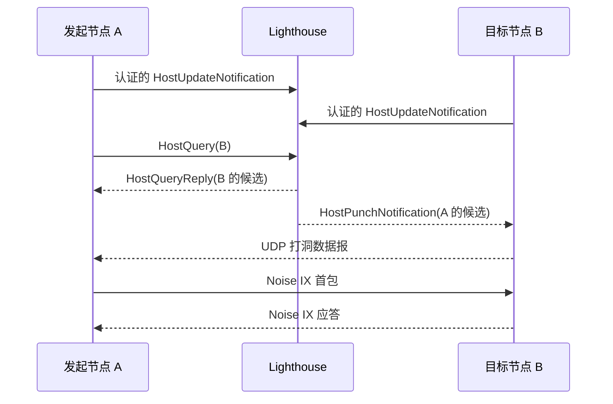

# Nebula 通信与安全设计参考

本文以本仓库 `bff32b0` 为实现基准，以 `slackhq/nebula@7876efa` 为上游对照。源码引用固定到该提交，便于对照函数与行号。上游 issue 记录需求或故障现象，PR 与官方文档说明协议取舍。配置和接入步骤见 [路径策略](docs/paths.md)、[网卡与管理 API](docs/nebula-nic.md) 和 [gVisor 接入示例](docs/quickstart.md)。[上游对照版本](https://github.com/slackhq/nebula/tree/7876efaaf499061109ca888f6ad4f197140087b8)

## 1. 分层与状态归属

一份 IP 包可能同时涉及三个地址：业务目的 IP、证书标识的 overlay 下一跳、实际写入的外层 UDP 端点。以访问下游子网为例，gVisor 选择网关 B，Nebula 再决定把发给 B 的密文直送还是交给中转 R。B 的证书必须授权该目的地址，R 只提供到 B 的传输路径。把这三层分开，应用可以在同一网关的不同外层路径之间切换，也可以用自己的路由表选择其他网关。[gVisor 输出](https://code.d7z.net/d7z-team/nebula/src/commit/bff32b062b4b565e7f4750919b2a2860be66ce38/nebulagvisor/endpoint.go#L71) · [IPPort 写入](https://code.d7z.net/d7z-team/nebula/src/commit/bff32b062b4b565e7f4750919b2a2860be66ce38/ip_port.go#L193) · [出站封装](https://code.d7z.net/d7z-team/nebula/src/commit/bff32b062b4b565e7f4750919b2a2860be66ce38/inside.go#L102)

| 层级 | 保存的事实 | 使用者 |
| --- | --- | --- |
| IP 路由 | 目的前缀、下一跳、逻辑网卡 | 应用与 gVisor。[网关配置](docs/nebula-nic.md#经网关访问下游子网) |
| 发现 | 某个 peer 可能使用的外层地址和中转 | lighthouse 缓存与握手调度器。[候选表](https://code.d7z.net/d7z-team/nebula/src/commit/bff32b062b4b565e7f4750919b2a2860be66ce38/remote_list.go#L56) |
| 会话 | 已认证的证书、双方会话索引、方向密钥、重放窗口 | 握手管理器、收发引擎。[会话状态](https://code.d7z.net/d7z-team/nebula/src/commit/bff32b062b4b565e7f4750919b2a2860be66ce38/connection_state.go#L28) |
| 路径 | 当前出口、备用路径、最近验证、失败退避 | 路径调度器。[路径状态](https://code.d7z.net/d7z-team/nebula/src/commit/bff32b062b4b565e7f4750919b2a2860be66ce38/path_health.go#L115) |

本仓库把 Nebula 暴露为 L3 `IPPort` 和 gVisor `LinkEndpoint`。内层 TCP、UDP 和 ICMP 都是 IP 包。外层通过 `DatagramTransport` 发送完整数据报，通常由操作系统 UDP socket 承载。每个报文独立认证，接收可容忍窗口内乱序。外层丢包的端到端恢复交给内层协议，因此切路不必等待旧路径上的数据被重传。每个节点拥有自己的发现、会话、调度与队列。成功创建节点后，节点负责关闭传输。应用提供的传输须保留数据报边界，并用 `Close` 唤醒阻塞 I/O。[Node 生命周期](https://code.d7z.net/d7z-team/nebula/src/commit/bff32b062b4b565e7f4750919b2a2860be66ce38/node.go#L102) · [DatagramTransport](https://code.d7z.net/d7z-team/nebula/src/commit/bff32b062b4b565e7f4750919b2a2860be66ce38/datagram.go#L17) · [gVisor 转发测试](https://code.d7z.net/d7z-team/nebula/src/commit/bff32b062b4b565e7f4750919b2a2860be66ce38/forwarding_test.go#L113)

## 2. 数据包与安全边界

- **线上封装。** 标准头为 16 字节，包含版本与类型各 4 位、子类型 8 位、保留字段 16 位、接收方会话或中转索引 32 位、消息计数器 64 位。普通数据和已建链控制包以头为 AEAD 附加数据，负载加密。中转外壳对外层头和整个内层报文做认证，保留内层报文给下一跳。单次封装增加 32 字节，单跳中转增加 64 字节，此外还有外层 IP、UDP 及可选 `DatagramMagic`。该前缀用于帧匹配，默认留空以保持上游互通。gVisor 默认 MTU 1300，部署时仍须结合实际下层 MTU。[协议头](https://code.d7z.net/d7z-team/nebula/src/commit/bff32b062b4b565e7f4750919b2a2860be66ce38/header/header.go#L10) · [附加认证与封装](https://code.d7z.net/d7z-team/nebula/src/commit/bff32b062b4b565e7f4750919b2a2860be66ce38/inside.go#L43) · [gVisor MTU](https://code.d7z.net/d7z-team/nebula/src/commit/bff32b062b4b565e7f4750919b2a2860be66ce38/nebulagvisor/endpoint.go#L18) · [上游中转缓冲边界 PR #1899](https://github.com/slackhq/nebula/pull/1899)
- **接收顺序。** 入口先校验长度、类型和索引，再按该会话验证 AEAD 和防重放。解密后的业务包还要通过路径策略和 IP 地址授权。经中转到达时，内层会话身份须与中转映射的 peer 一致。未知会话索引可能触发限速的 `RecvError`。接收侧把它作为尽快发起认证探测的提示。关闭会话的 `CloseTunnel` 走认证路径。由此把未经认证的故障提示和有权改变会话状态的消息区分开。[接收分派](https://code.d7z.net/d7z-team/nebula/src/commit/bff32b062b4b565e7f4750919b2a2860be66ce38/outside.go#L15) · [RecvError 处理](https://code.d7z.net/d7z-team/nebula/src/commit/bff32b062b4b565e7f4750919b2a2860be66ce38/outside.go#L313) · [上游 PR #1463](https://github.com/slackhq/nebula/pull/1463)
- **抗重放与密钥寿命。** 每方向使用独立密钥和发送计数器。建链时计入已使用的握手序号。接收侧以 8192 位滑动窗口容纳乱序，先读窗口，再验密文，通过后竞争提交新的接收记录。位图修改受锁保护，中转外壳也走相同的认证与窗口提交。日常换钥目标为每隧道发送计数达到 `2^34`。发送侧另有接近计数器上限的硬停止，防止同密钥 nonce 回绕。换钥门槛考虑 AES-GCM 在单密钥下处理的数据量，硬停止负责保护 nonce 唯一性。[本地计数器](https://code.d7z.net/d7z-team/nebula/src/commit/bff32b062b4b565e7f4750919b2a2860be66ce38/connection_state.go#L15) · [会话维护](https://code.d7z.net/d7z-team/nebula/src/commit/bff32b062b4b565e7f4750919b2a2860be66ce38/connection_manager.go#L295) · [上游 PR #1751](https://github.com/slackhq/nebula/pull/1751) · [PR #1802](https://github.com/slackhq/nebula/pull/1802) · [PR #1841](https://github.com/slackhq/nebula/pull/1841)
- **证书、地址和访问控制。** CA 签名约束节点身份、地址和授权子网。验证包括签名、有效期、签发者、曲线、CA 约束及指纹阻止名单。节点维护周期内复查已缓存证书。IP 入站须由该 peer 证书授权源地址、由本地证书授权目的地址，再经过可选 `InboundPolicy`。出站检查本地源和目标 peer 的目的地址权限，队列出队时按实际会话重新验证。与本地 overlay 网络重叠的 `UnsafeNetworks` 不能扩展成其他 overlay 节点的地址授权。应用层的端口、连接状态和业务 ACL 由宿主处理。已受信的 CA 决定谁能取得某个地址的有效身份，部署方也能通过证书的前缀与组约束限制签发范围。外层地址、报头和流量时序对转发链路可见。[CA 校验](https://code.d7z.net/d7z-team/nebula/src/commit/bff32b062b4b565e7f4750919b2a2860be66ce38/cert/ca_pool.go#L186) · [地址授权](https://code.d7z.net/d7z-team/nebula/src/commit/bff32b062b4b565e7f4750919b2a2860be66ce38/packet_address.go#L48) · [端口入站与出站](https://code.d7z.net/d7z-team/nebula/src/commit/bff32b062b4b565e7f4750919b2a2860be66ce38/ip_port.go#L156) · [上游 PR #1986](https://github.com/slackhq/nebula/pull/1986) · [签发者校验 PR #2053](https://github.com/slackhq/nebula/pull/2053)

## 3. Noise 握手与会话生命周期

线上使用两报文的 Noise IX，头部握手子类型名为 `ix_psk0`。本实现向 Noise 传入空 PSK，实际运行的是 IX。节点身份由 Noise 静态密钥与 CA 签发证书绑定。Noise 交换临时密钥并导出方向密钥。握手载荷携带会话索引、时间戳、证书版本与省略公钥后的证书。接收端以 Noise 得到的 `PeerStatic` 重组证书并核对公钥，再委托 CA 验证。发起方还检查证书确实包含所拨的 overlay 地址。曲线由证书决定，默认 AES-GCM，可配 ChaCha20-Poly1305。FIPS 140-only 路径要求 P-256 与 AES-GCM。证书 v1/v2 与协议头的版本字段独立。同一节点可以带共享静态私钥的两版证书。[握手格式](https://code.d7z.net/d7z-team/nebula/src/commit/bff32b062b4b565e7f4750919b2a2860be66ce38/handshake/patterns.go) · [Noise 参数](https://code.d7z.net/d7z-team/nebula/src/commit/bff32b062b4b565e7f4750919b2a2860be66ce38/handshake/credential.go#L38) · [证书重组](https://code.d7z.net/d7z-team/nebula/src/commit/bff32b062b4b565e7f4750919b2a2860be66ce38/handshake/machine.go#L342) · [本地 PKI](https://code.d7z.net/d7z-team/nebula/src/commit/bff32b062b4b565e7f4750919b2a2860be66ce38/pki.go#L22) · [Noise 规范](https://noiseprotocol.org/noise.html) · [上游 PR #769](https://github.com/slackhq/nebula/pull/769) · [PR #1566](https://github.com/slackhq/nebula/pull/1566)

| 阶段 | 本地行为与设计考量 |
| --- | --- |
| 发起 | 首包的接收方索引为 0、计数为 1。后续应答按待完成索引查找。发起对象按目标地址合并，创建时共享 lighthouse 候选表。静态地址及发现新结果可以驱动尝试。UDP 可能丢包，定时器以线性间隔重发同一首包，逐个轮转直连候选，随后也尝试获准的中转。默认基础间隔 100 ms、10 次尝试，第 5 次刷新发现。[握手入口与重试](https://code.d7z.net/d7z-team/nebula/src/commit/bff32b062b4b565e7f4750919b2a2860be66ce38/handshake_manager.go#L162) · [上游 PR #1909](https://github.com/slackhq/nebula/pull/1909) |
| 响应 | 验证证书、路径和索引后公布会话。重复的首包复用原应答，以免为同一尝试生成不同的响应端临时密钥。旧握手可按缓存结果与时序判定，错误身份对应的直连候选可暂时排除。[握手判定](https://code.d7z.net/d7z-team/nebula/src/commit/bff32b062b4b565e7f4750919b2a2860be66ce38/handshake_manager.go#L357) · [重复应答处理](https://code.d7z.net/d7z-team/nebula/src/commit/bff32b062b4b565e7f4750919b2a2860be66ce38/handshake_manager.go#L962) |
| 完成 | `handshake.Machine` 负责 Noise、载荷和证书重组，管理器处理角色、路径、索引、重传和队列。发起侧在锁内从 pending 删除原目标，再发布证书认证出的别名。缓存控制包走当前有效会话。计时任务携带握手对象，过期任务不会驱动新一轮尝试。[协议状态机](https://code.d7z.net/d7z-team/nebula/src/commit/bff32b062b4b565e7f4750919b2a2860be66ce38/handshake/machine.go#L57) · [会话发布](https://code.d7z.net/d7z-team/nebula/src/commit/bff32b062b4b565e7f4750919b2a2860be66ce38/handshake_manager.go#L408) · [计时回归](https://code.d7z.net/d7z-team/nebula/src/commit/bff32b062b4b565e7f4750919b2a2860be66ce38/handshake_manager_test.go#L11) · [上游 PR #1656](https://github.com/slackhq/nebula/pull/1656) |
| 并发与换钥 | 多条 Noise 会话可短暂共存，使双方同时发起、旧包在途和密钥更新有重叠窗口。host map 为每地址保留有限会话（默认 5），连接管理器按入站活动、确定性的地址顺序及删除周期收敛，并处理证书失效与重握手。外层路径切换通常可以沿用现有会话密钥。[host map](https://code.d7z.net/d7z-team/nebula/src/commit/bff32b062b4b565e7f4750919b2a2860be66ce38/hostmap.go#L351) · [连接维护](https://code.d7z.net/d7z-team/nebula/src/commit/bff32b062b4b565e7f4750919b2a2860be66ce38/connection_manager.go#L171) · [上游 PR #820](https://github.com/slackhq/nebula/pull/820) |

## 4. Lighthouse 与 NAT 打洞

图中展示直连成功的一种时序。首个握手包可能早于对端打洞，后续重传仍有机会穿过已打开的映射。

- **登记与查找。** 客户端用预设外层地址找到 lighthouse，再定期上报地址和可用中转。与 lighthouse 新建会话或执行 Rebind 时也触发更新。登记身份来自已认证证书，请求回复与打洞通知仅接受配置的 lighthouse 身份。节点保留静态配置、对端通告以及从认证流量学习的 UDP 地址，并按来源分别保存发现记录。候选快照做过滤、去重和排序。每条上报分别限制 IPv4、IPv6 和中转条数。v1 discovery 的 overlay 身份与 relay 地址走旧 IPv4 字段，v2 使用可表达 IPv4 与 IPv6 的地址字段。外层 UDP 地址族可以与 overlay 地址族不同。优先网段为冷启动提供尝试顺序，随后在同组内按 IPv6、非私有 IPv4、私有 IPv4 排序。[更新处理](https://code.d7z.net/d7z-team/nebula/src/commit/bff32b062b4b565e7f4750919b2a2860be66ce38/lighthouse.go#L743) · [候选排序](https://code.d7z.net/d7z-team/nebula/src/commit/bff32b062b4b565e7f4750919b2a2860be66ce38/remote_list.go#L117) · [上游 lighthouse 配置](https://nebula.defined.net/docs/config/lighthouse/) · [即时更新 PR #1645](https://github.com/slackhq/nebula/pull/1645) · [先过滤再截断 PR #1985](https://github.com/slackhq/nebula/pull/1985)
- **发现与信任。** lighthouse 丢失或返回陈旧数据会影响新连接和恢复，已知端点与已有可用会话仍可能直接通信。节点可配置多个 lighthouse，并向各自登记。各 lighthouse 独立维护收到的记录。上游将目录之间不复制记录解释为隔离单个 lighthouse 失陷的影响。共享同一个 lighthouse 有助于发现。静态候选也能提供入口。掌握目录可以影响候选和可达性，不能代替端点完成匹配身份的握手。[查询发送](https://code.d7z.net/d7z-team/nebula/src/commit/bff32b062b4b565e7f4750919b2a2860be66ce38/lighthouse.go#L356) · [上游 issue #109 的维护者回复](https://github.com/slackhq/nebula/issues/109#issuecomment-567175080)
- **打洞与保活。** 查询有记录时，lighthouse 把 B 的候选发给 A，同时把 A 的候选通知 B。B 调度短 UDP 打洞包，为 NAT 映射和过滤建立出站状态。可选 `Respond` 在延迟后触发认证 Test，必要时也带起反向握手。`Punch` 控制会话维护中的周期性保活打洞，通知触发的工作由独立的有界调度队列承接。发送前重新检查路径策略，`RelayOnly` 会抑制对该端点的直连打洞。短 UDP 包只协助底层连通，认证 Test 才提供会话与可达性证据。[查询与通知](https://code.d7z.net/d7z-team/nebula/src/commit/bff32b062b4b565e7f4750919b2a2860be66ce38/lighthouse.go#L607) · [打洞调度](https://code.d7z.net/d7z-team/nebula/src/commit/bff32b062b4b565e7f4750919b2a2860be66ce38/punchy.go#L51) · [上游 punchy 配置](https://nebula.defined.net/docs/config/punchy/) · [合并调度 PR #1708](https://github.com/slackhq/nebula/pull/1708) · [上游打洞白名单 PR #1186](https://github.com/slackhq/nebula/pull/1186)
- **穿透边界。** 从 lighthouse 观察到的公网端点，与向另一对端发包时的映射可能不同。NAT 的映射、入站过滤、hairpin 和 UDP 策略也各自影响结果。issue #1368 报告即使测得端点无关映射，双方仍可能无法直接通信。#889 记录外层 NAT 公网地址变化后的重连问题。对本分支而言，候选顺序是先验判断，新外层地址需通过会话或同路探测确认，直连失败时可以使用预先配置或发现的中转。上游的 `remote_allow_list` 讨论表达的是其 YAML 端点过滤机制，本分支的 Go 路径策略按 peer 和中转身份决策。[RFC 4787](https://www.rfc-editor.org/rfc/rfc4787) · [上游 issue #1368](https://github.com/slackhq/nebula/issues/1368) · [issue #889](https://github.com/slackhq/nebula/issues/889) · [IPv6 候选讨论 #1486](https://github.com/slackhq/nebula/issues/1486)

## 5. 单跳中转与路径策略

A 和 B 各自与 R 建立直连会话。A 用已认证的 `CreateRelayRequest` 请求 R，R 向 B 协调反向映射，回应交换各自的本地与远端索引。映射就绪后端点可经 R 完成 A–B 的 Noise 握手，也可为已建立的 A–B 会话增加备用出口。实际转发中，R 验证 A–R 外层、查找成立且成对的映射，使用 R–B 的密钥和计数器重建外层。内层业务密文由 B 使用 A–B 的密钥解开。R 可以观察报文长度、时序与关联的端点，拥有丢弃或延迟转发的能力。邻接握手限为直连，控制和数据入口拒绝递归中转，以避免循环拓扑。重复请求复用映射，限制重试频率并回收半开条目。[邻接和中转控制](https://code.d7z.net/d7z-team/nebula/src/commit/bff32b062b4b565e7f4750919b2a2860be66ce38/relay_manager.go#L192) · [数据转发](https://code.d7z.net/d7z-team/nebula/src/commit/bff32b062b4b565e7f4750919b2a2860be66ce38/outside.go#L196) · [上游 PR #1980](https://github.com/slackhq/nebula/pull/1980) · [中转测试 PR #691](https://github.com/slackhq/nebula/pull/691)

`Auto` 冷启动优先尝试直连。`DirectOnly` 允许多个直连候选。`RelayOnly` 要求本机对此 peer 的握手、业务、探测和关闭通知通过获准的单跳中转。策略针对证书身份，已确认别名的显式限制取交集。运行时改策略会与传输提交同步，旧探测因策略版本变更失效，已经提交给旧路径的 UDP 包仍可能到达。策略由两端各自执行。只配置一端时，另一端仍可能尝试直连。上游维护者在 #1781 把 relay 定位为 mesh 的备用路径，建议用端点过滤实现某些限制。本分支增加逐 peer 的强制中转接口，复用标准中转报文。[策略提交及校验](https://code.d7z.net/d7z-team/nebula/src/commit/bff32b062b4b565e7f4750919b2a2860be66ce38/path_policy.go#L131) · [上游 issue #1781 的维护者回复](https://github.com/slackhq/nebula/issues/1781#issuecomment-4906838300)

中转索引属于分配它的节点。收到回应时，使用本地索引找映射，再用远端索引发给邻接节点。映射替换后，旧索引不能证明新路径就绪。上游 PR #1805 记录过本地/远端索引混用令单侧拆除后的中转迟迟无法恢复。这个案例也解释了本分支为什么将外层地址、relay 会话和两侧索引共同纳入路径有效性检查。[中转路径校验](https://code.d7z.net/d7z-team/nebula/src/commit/bff32b062b4b565e7f4750919b2a2860be66ce38/path_policy.go#L330) · [上游 PR #1805](https://github.com/slackhq/nebula/pull/1805)

## 6. 路径验证、故障切换与恢复

上游 issue #1748 记录了一个单向黑洞：旧直连地址仍在缓存，密文持续发往失效直连。与此同时，经 relay 的入站流量让会话继续显得活跃。它揭示了单独看入站活跃、地址存在或 UDP 写成功的局限。本分支将当前业务出口和会话分开维护，用同一会话在备路发送少量认证探测，主路继续承载全部业务。收到新地址上的认证流量时先登记漫游候选，再用同路往返结果更新直连端点。[上游 issue #1748](https://github.com/slackhq/nebula/issues/1748) · [漫游候选](https://code.d7z.net/d7z-team/nebula/src/commit/bff32b062b4b565e7f4750919b2a2860be66ce38/outside.go#L297) · [路径状态](https://code.d7z.net/d7z-team/nebula/src/commit/bff32b062b4b565e7f4750919b2a2860be66ce38/path_health.go#L115)

| 信号或事件 | 本地决策 |
| --- | --- |
| 收到认证 Test 回显 | 标准 `TestRequest/TestReply` 载荷使用标记和随机 ID。回显须匹配当前会话、在途请求、绑定代数和策略版本。记录 `Sent` 与 `Received`。只有同路成功样本更新 RTT 和抖动。策略允许的非对称回程可提供双向可达证据。收到违反路径策略的回程时，记为策略错误。[回显归因](https://code.d7z.net/d7z-team/nebula/src/commit/bff32b062b4b565e7f4750919b2a2860be66ce38/path_probe.go#L26) |
| 等待回显超时 | 超时从传输接受探测后开始，后续使用 `SRTT + 4 × RTT 偏差`，限制在 300 ms 至 5 s。预算不足、本地提交失败和旧会话应答单独处置。主路默认连续 3 次实际探测超时后退出活动状态。近期成功的备路可以立即接管。失败路径随后退避，默认初始 30 s，上限 5 分钟。[探测发出](https://code.d7z.net/d7z-team/nebula/src/commit/bff32b062b4b565e7f4750919b2a2860be66ce38/path_probe.go#L79) · [超时处理](https://code.d7z.net/d7z-team/nebula/src/commit/bff32b062b4b565e7f4750919b2a2860be66ce38/path_probe.go#L325) · [记录与接管](https://code.d7z.net/d7z-team/nebula/src/commit/bff32b062b4b565e7f4750919b2a2860be66ce38/path_health.go#L227) |
| 备路质量更高 | 成本为 `SRTT + 2 × jitter + Timeouts/Samples × max(200 ms, 4 × SRTT)`。备路需连续胜出并积累同路样本（默认均为 3），改善至少为 15 ms 与当前成本 20% 中的较大者。性能切换还需满足默认 30 s 的主路保持期。单条高抖动但可用的线路继续服务，同时寻找备选。[评分和滞后](https://code.d7z.net/d7z-team/nebula/src/commit/bff32b062b4b565e7f4750919b2a2860be66ce38/path_health.go#L45) · [默认阈值](https://code.d7z.net/d7z-team/nebula/src/commit/bff32b062b4b565e7f4750919b2a2860be66ce38/path_options.go#L59) |
| 多个 peer 共用的 R 出现故障 | 将端到端失败归到“经 R 到目标 B”。另外对 A–R 共享直连邻接合并复核。邻接失效会使依赖该邻接的中转路径失效。无可用路时尝试候选。邻接仍通但端到端失败时，可按恢复间隔重握手以修复失效的端到端会话或回程。[邻接复核](https://code.d7z.net/d7z-team/nebula/src/commit/bff32b062b4b565e7f4750919b2a2860be66ce38/path_health.go#L167) · [恢复决策](https://code.d7z.net/d7z-team/nebula/src/commit/bff32b062b4b565e7f4750919b2a2860be66ce38/path_probe.go#L359) |
| 本地 Rebind 或上游回程不对称 | Rebind 增加本地绑定代数并触发上报，旧测量与应答不能提升新路径。后续会话发送触发重新发现。上游可以回显标准 Test，但可能沿自己的当前路径回复。互通测试覆盖探测经中转发送、直接返回，以及切成严格中转后双方沿中转收发。[Rebind](https://code.d7z.net/d7z-team/nebula/src/commit/bff32b062b4b565e7f4750919b2a2860be66ce38/node.go#L252) · [互通测试](https://code.d7z.net/d7z-team/nebula/src/commit/bff32b062b4b565e7f4750919b2a2860be66ce38/interop_test.go#L89) · [上游漫游测量 PR #1819](https://github.com/slackhq/nebula/pull/1819) |

探测以活跃主路约 10 s、备路约 30 s 随机错峰。默认空闲 1 分钟后暂停常规质量采样，设 `MonitorInterval` 可继续监控关键 peer。每会话同一时间只有一个探测。调度器轮转共享预算，常规采样默认持续速率约 20 次/s，主动控制写入还有独立预算。若 1,000 个活跃 peer 都以默认主备间隔采样，期望需求约为 133 次/s，实际周期会随预算拉长。查询队列会合并同一地址的在途请求，后台查询在队列满时让出，手动刷新可通过 context 等待入队。这些约束限制重绑和共享中转故障时的控制开销。转发业务吞吐的隔离是独立问题，上游 issue #1300 讨论了为共享 relay 提供带宽分配的需求。[调度与预算](https://code.d7z.net/d7z-team/nebula/src/commit/bff32b062b4b565e7f4750919b2a2860be66ce38/path_probe.go#L276) · [探测默认值](https://code.d7z.net/d7z-team/nebula/src/commit/bff32b062b4b565e7f4750919b2a2860be66ce38/path_options.go#L59) · [发现限流 PR #1910](https://github.com/slackhq/nebula/pull/1910) · [上游 issue #1300](https://github.com/slackhq/nebula/issues/1300)

应用的网关切换有另一层代价。换到同一个 B 的备路，可以继续用既有端到端会话。若 gVisor 把流量交给另一个 overlay 网关，NAT、状态防火墙和网关上终止的 TCP 都可能依赖原来的流。上游 PR #2013 在其 `unsafe_routes` ECMP 中等待哈希选中的网关完成握手，避免同一连接跨网关分裂。本分支把网关选择交给应用的路由层，这个案例说明了两层应分别衡量故障和恢复。[gVisor 下一跳](https://code.d7z.net/d7z-team/nebula/src/commit/bff32b062b4b565e7f4750919b2a2860be66ce38/nebulagvisor/endpoint.go#L71) · [上游 ECMP PR #2013](https://github.com/slackhq/nebula/pull/2013)

## 7. 可观测性与验证

| 需要确认的问题 | 入口及证据 |
| --- | --- |
| 已发现哪些地址，是否已经开始握手？ | `PeerDiscovery` 读取候选快照，`RefreshPeer` 等待查询入队，`Peer` 显示会话或待完成握手。系统收到发现回复时触发尝试，逻辑上的就绪条件由 `ConnectPeer` 检查会话与合法出口。[发现 API](https://code.d7z.net/d7z-team/nebula/src/commit/bff32b062b4b565e7f4750919b2a2860be66ce38/management_discovery.go) · [就绪条件](https://code.d7z.net/d7z-team/nebula/src/commit/bff32b062b4b565e7f4750919b2a2860be66ce38/peer_management.go#L261) |
| 当前路是否实际交付，哪个方向异常？ | `CheckPeerPath` 报告认证往返的去程与回程。`PathHealth` 记录主备、测量间隔、超时及最近换路原因。`LastDataPath` 仅记录最后一次被外层传输接受的业务包路径。诊断实际交付需要接收侧的业务或端口统计。[路径快照](https://code.d7z.net/d7z-team/nebula/src/commit/bff32b062b4b565e7f4750919b2a2860be66ce38/path_health.go#L193) · [IPPort 计量](https://code.d7z.net/d7z-team/nebula/src/commit/bff32b062b4b565e7f4750919b2a2860be66ce38/ip_port.go#L126) |
| 中转或排队是否成了瓶颈？ | `RelayStats` 包含转发数和映射使用量，`IPPort.Stats` 包含排队、拒绝与收发。默认 IP 队列是每端口 512、每 peer 100。只在明确未提交的部分路径错误时回队，成功写入后由内层协议处理可靠性。[中转统计](https://code.d7z.net/d7z-team/nebula/src/commit/bff32b062b4b565e7f4750919b2a2860be66ce38/relay_manager.go#L29) · [端口队列](https://code.d7z.net/d7z-team/nebula/src/commit/bff32b062b4b565e7f4750919b2a2860be66ce38/ip_port.go#L185) · [容量配置](docs/nebula-nic.md#调整节点容量) |

本地测试覆盖 Noise IX、恶意或错误证书的拒绝、首包重传相关状态、发现触发的握手、双角色单跳中转、认证探测和故障接管、策略变更、共享中转故障、千会话重绑、上游 v1/v2 互通及 gVisor 双栈转发。内存传输测试用于控制丢包、延时和时间推进，真实上游二进制用例验证双向发起与混合中转。可用上游 `7876efa` 可执行文件复核这组 UDP 握手和单跳中转场景。不同 NAT 设备的实际穿透条件由部署环境决定。[握手测试](https://code.d7z.net/d7z-team/nebula/src/commit/bff32b062b4b565e7f4750919b2a2860be66ce38/handshake/machine_test.go) · [路径测试](https://code.d7z.net/d7z-team/nebula/src/commit/bff32b062b4b565e7f4750919b2a2860be66ce38/path_test.go) · [上游互通](https://code.d7z.net/d7z-team/nebula/src/commit/bff32b062b4b565e7f4750919b2a2860be66ce38/interop_test.go) · [gVisor 转发](https://code.d7z.net/d7z-team/nebula/src/commit/bff32b062b4b565e7f4750919b2a2860be66ce38/forwarding_test.go) · [运行测试](README.md#testing)
